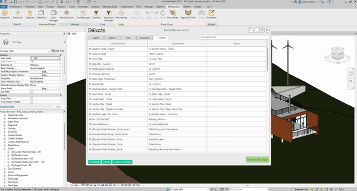

# Health
{: .no_toc }

Check your model's loadable families for warnings and errors, see their file sizes, and find out which families need attention.
{: .fs-6 .fw-300 }

## Table of contents
{: .no_toc .text-delta }

1. TOC
{:toc}

---

## Run a health check

1. Open **FamilyReviser** and select the **Health** tab. The list shows the name and type of each editable loadable family. System families, such as walls and floors, are not included.

2. Click **Run Health Check**. FamilyReviser checks each family and fills in the **File Size** and **Status** columns. In Revit 2027, read the warning shown before the check and choose whether to continue.

3. When the check finishes, review the results. Click a **Warning** or **Invalid** icon to read the messages for that family type.

> If you load, delete, or rename families after opening the Health tab, close and reopen FamilyReviser before running the check. Otherwise, the list may be out of date. A deleted family can stop the check before it finishes.
{: .warning }

> Screenshots may show an earlier version of FamilyReviser.
{: .note }

The check opens families one at a time, so larger family collections can take longer. To stop, click **Cancel**. Results already collected remain in the list; unchecked types stay blank.

## Understand the results

- **Valid:** none of the checks found a problem.
- **Warning:** at least one warning was found, but no errors.
- **Invalid:** an error was found, or FamilyReviser could not complete the check for that family.

> A Valid result means the family passed these checks. It is not a complete assessment of its quality or performance.
{: .note }

Results are listed by family type. A problem found in the family itself appears against all its types. Duplicate messages are shown only once for each type.

## What is checked and how to fix it

### Revit warnings and errors

FamilyReviser reads the warnings stored inside each family, such as overlapping lines. It shows Revit's own messages so you can identify the issue.

To investigate, edit the family in Revit and open **Manage > Inquiry > Warnings**. Resolve the reported issues, load the updated family back into your project, and run the check again.

### Families that could not be checked

If FamilyReviser cannot open a family or read its file size, the result is **Invalid** and no file size is shown. Click the icon to see the reason.

- **File not found:** the original family file may have been moved, renamed, or deleted. Restore it at the path shown in the message and run the check again. The family may still open in your project even though that file is missing.
- **Another error:** try editing the family in Revit. If it cannot be opened, replace it with a working copy.

### Missing family or type information

FamilyReviser also looks for these less common issues. Messages may use the term *family symbol*, which means a family type.

- **No valid category — Invalid:** edit the family and assign a category using **Family Category and Parameters**.
- **No valid family — Invalid:** reload the family from its original file.
- **No parameters — Warning:** reload the family from its original file.
- **No valid type name — Warning:** give the type a name in **Type Properties**.

## Understand file sizes

**File Size** shows the family file's size in MB. FamilyReviser reads the file at the path stored by Revit. If no path is stored, it measures a temporary copy and deletes that copy after the check.

The value describes the family file; it does not measure how much memory the family uses in your project. When an existing file is measured, its size may differ from the family currently edited in the model.

## Export or select results

Click **Export to Excel** to save the results. Each family type gets a row with its family name, type name, file size, status, and messages. The **Warnings** column includes both warnings and errors.

To select a family type in Revit, right-click its row and choose **Select Highlighted Elements**.

---

For more FamilyReviser tutorials, visit the DiRoots YouTube channel.

[DiRoots Channel](https://www.youtube.com/@DiRootsNews){: .btn .btn-di-orange }